<p align="center">
  
</p>

<h1 align="center">PylandTweaks</h1>

<p align="center">
  <strong>Optimizador de Windows para equipos de gama baja</strong><br>
  Versión 5.8 &middot; Windows 10 / 11 (64 bits)
</p>

<p align="center">
  <a href="../../releases/latest">
    
  </a>
  
  
  
</p>

> **Aviso importante**
>
> PylandTweaks modifica servicios, tareas programadas, el registro y opciones de
> Windows Update y Windows Defender. Crea un **punto de restauración** antes de
> aplicar cambios y **reinicia** el equipo al terminar.
> No está afiliado a Microsoft.

## Qué es

PylandTweaks es una aplicación de escritorio (Tkinter) y una alternativa por línea
de comandos para optimizar Windows. Reúne ajustes de rendimiento, latencia,
limpieza, apariencia y mantenimiento en una sola interfaz, con opciones de
reversión para volver atrás.

La aplicación incluye:

- Interfaz gráfica en español con tema oscuro.
- Registro de actividad y barra de estado en tiempo real.
- Permisos de administrador solicitados automáticamente.
- Modo temporal seguro para pausar Defender y Windows Update sin borrar archivos
  ni renombrar librerías del sistema.

## Características

| Pestaña | Qué incluye |
| --- | --- |
| **Recomendado** | Paquete completo: svchost, WiFi Sense, tareas de Update, telemetría, servicios, ajustes visuales, Teredo y caché DNS. |
| **Latencia** | Plan Ultimate/High Performance, CPU al 100%, Game Mode, Game Bar/DVR off, pantalla completa y aceleración del ratón off. |
| **Reversión** | Restaura servicios, registro, tareas, prioridad de juegos, GameDVR, Teredo, Defender y Windows Update. |
| **Sistema** | Servicios en manual/deshabilitados, telemetría, svchost, prioridad de juegos, calidad visual y apps en segundo plano. |
| **Apariencia** | Tema oscuro/claro, transparencia, Cortana y Action Center. |
| **Recursos** | Mem Reduct, compresión de RAM, plan de energía, InSpectre, prioridad de CPU, optimización de SSD, servicios y telemetría. |
| **Herramientas** | Defender y Windows Update (activar/desactivar), modo temporal seguro, punto de restauración, archivos temporales, caché DNS y Teredo. |
| **Acerca de** | Versión, créditos y consejos de seguridad. |

También se incluye `Aplicar Optimizaciones.bat`, un menú por consola con las
mismas funciones principales.

## Requisitos

- Windows 10 u 11 de 64 bits.
- Permisos de administrador.
- Para el instalador o el ejecutable portable: **no necesitas Python**.
- Para ejecutar desde el código: Python 3.10 o superior (con Tkinter).

## Instalación

### Opción 1: Instalador (recomendado)

1. Entra en [Releases](../../releases/latest).
2. Descarga `PylandTweaks_Setup_5.8.exe`.
3. Ejecuta el instalador y acepta el aviso de UAC.
4. Elige la carpeta y finaliza. Se crean accesos en el menú Inicio y, si quieres,
   en el escritorio.

El instalador incluye desinstalador y no necesita conexión a internet.

> El ejecutable no está firmado digitalmente. Si SmartScreen muestra una
> advertencia, verifica el hash SHA-256 (ver más abajo) y usa
> *Más información > Ejecutar de todas formas*.

### Opción 2: Ejecutable portable

Descarga `PylandTweaks.exe` desde [Releases](../../releases/latest) y ejecútalo.
Es un único archivo: no requiere instalación ni Python.

### Opción 3: Desde el código

```powershell
git clone https://github.com/pyland-tweaks/PylandTweaks.git
cd PylandTweaks
python Optimizador_GUI.py
```

También puedes hacer doble clic en `PylandTweaks.bat`.

## Uso rápido

1. Abre PylandTweaks como administrador.
2. Ve a **Recomendado** y pulsa **Crear punto de restauración**.
3. Pulsa **Aplicar optimizaciones recomendadas**.
4. **Reinicia** el equipo cuando la aplicación lo indique.
5. Si algo no te convence, abre **Reversión** y pulsa
   **Revertir todas las optimizaciones**; después reinicia.

> Deshabilitar Windows Defender deja el equipo sin protección antivirus.
> Si solo necesitas un ajuste puntual, usa el **Modo temporal (seguro)** y
> reactiva todo desde la misma pestaña.

## Modo temporal (seguro)

Desde **Herramientas > Modo temporal (seguro)** puedes:

- Pausar Windows Defender (protección en tiempo real).
- Pausar Windows Update (servicios y tareas).
- Reactivar ambos con **Reactivar Defender + Update**.

No se borran archivos de Windows Update ni se renombran DLLs. Es la opción
recomendada frente a desactivar Defender o Update de forma permanente.

## Seguridad y reversión

- Crea siempre un **punto de restauración** antes de aplicar cambios.
- La pestaña **Reversión** restaura los valores predeterminados de Windows.
- Desinstalar PylandTweaks **no revierte** las optimizaciones: usa la pestaña
  **Reversión** antes de desinstalar.
- Revisa el código: es Python y scripts de Windows, todo visible en este
  repositorio.

## Compilar

### Ejecutable

```powershell
python -m pip install -r requirements-build.txt
.\build_exe.bat
```

Resultado: `dist\PylandTweaks.exe`.

### Instalador

Instala [Inno Setup 6](https://jrsoftware.org/isinfo.php) y ejecuta:

```powershell
.\build_installer.bat
```

Resultado: `installer\Output\PylandTweaks_Setup_5.8.exe`.

## Estructura del proyecto

```text
PylandTweaks/
|-- Optimizador_GUI.py         # Aplicación Tkinter
|-- Aplicar Optimizaciones.bat # Menú por consola
|-- PylandTweaks.bat           # Lanzador desde el código
|-- build_exe.bat              # Build del ejecutable
|-- build_installer.bat        # Build del instalador
|-- installer/                 # Script y aviso de Inno Setup
|-- assets/                    # Logo e iconos
|-- Apariencia/                # Archivos .reg de apariencia
|-- Recursos/                  # Herramientas y ajustes externos
|-- requirements-build.txt     # Dependencias solo para compilar
|-- LICENSE
`-- THIRD_PARTY_NOTICES.md
```

## Verificar descargas (SHA-256)

En PowerShell, dentro de la carpeta donde descargaste el archivo:

```powershell
Get-FileHash .\PylandTweaks_Setup_5.8.exe -Algorithm SHA256
```

Compara el resultado con el valor publicado en la release. Si no coincide, no
ejecutes el archivo.

## Créditos

- Inspirado en el trabajo de **Chris Titus Tech (WinUtil)**.
- **Mem Reduct** de Henry++.
- **InSpectre** de Steve Gibson (GRC).
- **Quick CPU** de CoderBag.

Consulta [THIRD_PARTY_NOTICES.md](THIRD_PARTY_NOTICES.md) para licencias y enlaces.

## Licencia

[MIT](LICENSE) © 2026 PylandTweaks.

## Aviso legal

PylandTweaks se distribuye **tal cual**, sin garantía de ningún tipo. El uso de
las optimizaciones es responsabilidad del usuario. Algunos cambios pueden afectar
la seguridad, las actualizaciones del sistema o el comportamiento de Windows.
Windows es una marca registrada de Microsoft Corporation; este proyecto no está
afiliado ni respaldado por Microsoft.
